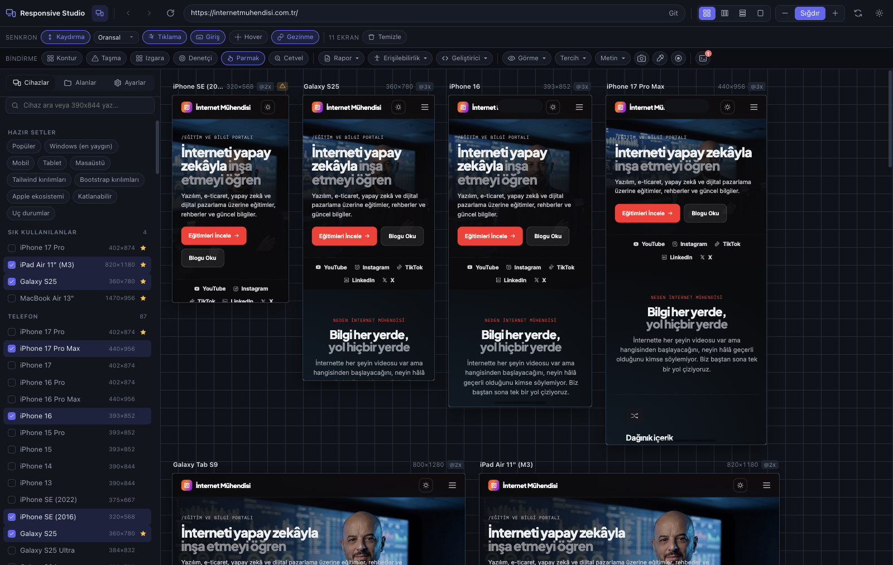
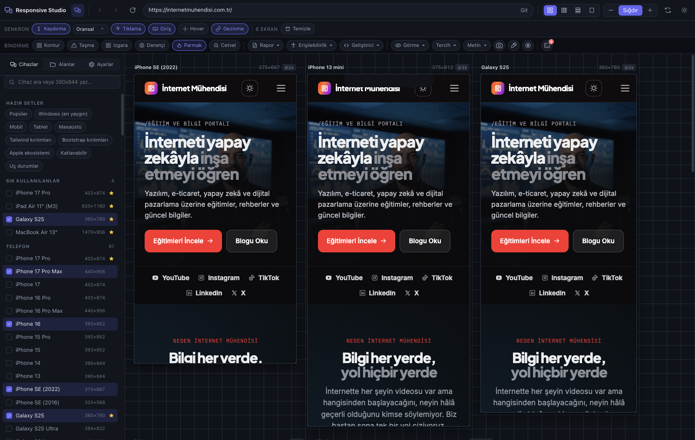

# Responsive Studio

Açık olan siteyi **onlarca cihaz boyutunda aynı anda**, canlı ve etkileşimli görüntüleyen
Chrome eklentisi. Bir ekranda kaydırın, tıklayın, form doldurun — hepsi birlikte hareket eder.
Web tasarımcıları ve geliştiriciler için çoklu ekran test stüdyosu.

  



<details>
<summary>Mobil set görünümü</summary>



</details>

---

## Kurulum (yaklaşık 2 dakika)

Eklenti Chrome Web Mağazası'nda değil; GitHub'dan indirip Chrome'a kendiniz yüklersiniz.
Programlama bilgisi gerekmez.

1. **[Son sürüm sayfasından](https://github.com/cankarfx/responsive-studio/releases/latest)** `responsive-studio-vX.Y.Z.zip` dosyasını indirin
2. ZIP'i açın ve çıkan **`responsive-studio`** klasörünü kalıcı bir yere taşıyın
   (ör. `Belgeler`). ⚠️ Bu klasörü sonradan silerseniz ya da taşırsanız eklenti çalışmaz
3. Chrome'da adres çubuğuna **`chrome://extensions`** yazın
4. Sağ üstteki **Geliştirici modu** anahtarını açın
5. **Paketlenmemiş öğe yükle** düğmesine basın ve 2. adımdaki **`responsive-studio`**
   klasörünü seçin (içinde `manifest.json` olan klasör)
6. Bulmaca ikonundan 🧩 Responsive Studio'yu araç çubuğuna sabitleyin

Hazır! Herhangi bir sitede eklenti ikonuna basın ya da
<kbd>Ctrl</kbd>+<kbd>Shift</kbd>+<kbd>Y</kbd> (Mac: <kbd>⌘</kbd>+<kbd>Shift</kbd>+<kbd>Y</kbd>).

> **Kurulumda çıkan "tüm web sitelerindeki verilerinizi okuyup değiştirebilir" uyarısı
> neden?** Eklentinin, test ettiğiniz sitenin içine girip onu telefon gibi davrandırması
> gerekiyor. Hiçbir veri dışarı gönderilmez — ayrıntı için [Gizlilik ve güvenlik](#gizlilik-ve-güvenlik).

> **Yerel dosyalar (`file://`)** için `chrome://extensions` → Responsive Studio →
> *Ayrıntılar* → **Dosya URL'lerine erişime izin ver** seçeneğini açın.

### Güncelleme

Geliştirici modundaki eklentiler kendiliğinden güncellenmez. Yeni sürüm çıktığında:

1. [Son sürüm sayfasından](https://github.com/cankarfx/responsive-studio/releases/latest) yeni ZIP'i indirin
2. Eski `responsive-studio` klasörünün **içeriğini** yeni ZIP'teki dosyalarla değiştirin
3. `chrome://extensions` sayfasında Responsive Studio kartındaki ↻ (yenile) düğmesine basın

Ayarlarınız, cihazlarınız ve çalışma alanlarınız korunur.

### Kaynaktan derlemek (geliştiriciler)

```bash
npm install
npm run build      # çıktı: dist/
```

Ardından yukarıdaki 3–5. adımlarda **`dist`** klasörünü seçin.

## Kullanım

| Yol | Nasıl |
|---|---|
| Araç çubuğu ikonu | Açık sayfayı stüdyoda açar |
| <kbd>Ctrl</kbd>+<kbd>Shift</kbd>+<kbd>Y</kbd> (<kbd>⌘</kbd>+<kbd>Shift</kbd>+<kbd>Y</kbd>) | Aynısı, klavyeden |
| Sağ tık → *Bu sayfayı Responsive Studio'da aç* | Sayfa veya bağlantı için |

### Arayüz

Her düğmenin üzerine gelince ne işe yaradığını anlatan bir ipucu çıkar. Araç çubuğunda sık
kullanılan bindirme araçları (Kontur, Taşma, Izgara, Denetçi, Cetvel) doğrudan düğme; raporlar,
erişilebilirlik denetimleri ve geliştirici araçları menülerde toplanmış; ekran görüntüsü,
damlalık, kayıt ve konsol ise ikon olarak sağda.

### Klavye kısayolları (stüdyo içinde)

| Kısayol | İşlev |
|---|---|
| <kbd>Ctrl</kbd>+<kbd>L</kbd> | Adres çubuğu |
| <kbd>Ctrl</kbd>+<kbd>R</kbd> | Tüm ekranları yenile |
| <kbd>Ctrl</kbd>+<kbd>B</kbd> | Yan paneli aç/kapat |
| <kbd>Ctrl</kbd>+<kbd>0</kbd> | Ölçeği sığdır |
| <kbd>Ctrl</kbd>+<kbd>+</kbd> / <kbd>-</kbd> | Yakınlaştır / uzaklaştır |
| <kbd>R</kbd> | Tüm ekranları çevir |
| <kbd>O</kbd> / <kbd>T</kbd> / <kbd>G</kbd> / <kbd>I</kbd> / <kbd>M</kbd> | Kontur / Taşma / Izgara / Denetçi / Cetvel |
| <kbd>Esc</kbd> (cetvelde) | Ölçümü sıfırla |
| — | Erişilebilirlik denetimleri araç çubuğundaki *Erişilebilirlik* menüsünde |
| <kbd>←</kbd><kbd>→</kbd><kbd>↑</kbd><kbd>↓</kbd> | Tasarım bindirmesini hizala (<kbd>Shift</kbd> = 10px) |
| <kbd>Esc</kbd> | Tek-ekran modundan çık |

---

## Neler var

### Cihazlar ve ekranlar

- **191 cihaz** — iPhone 5'ten iPhone 17 Pro Max'e, Galaxy/Pixel/Xiaomi, iPad'ler,
  katlanabilirler, MacBook/Surface, 4K ve ultra geniş monitörler, Apple Watch, TV, Steam Deck
- **Windows kurulumları ölçekleme farkındalıklı** — 1920×1080 ekran %125 ölçeklemede
  `1536×736` viewport ve `devicePixelRatio: 1.25` demektir; `srcset` ve `image-set()`
  davranışını bu belirler. Masaüstü presetleri **ekran değil tarayıcı viewport'u** ölçüsündedir
  (ekran yüksekliği − görev çubuğu − tarayıcı arayüzü), `screen.width/height` ise gerçek
  ekranı bildirir
- **Hazır setler** — Popüler, **Windows (en yaygın)**, Mobil, Tablet, Masaüstü, Tailwind,
  Bootstrap, Material, Apple ekosistemi, Katlanabilir, Uç durumlar. Açılışta hangi setin
  yükleneceğini Ayarlar'dan seçebilirsiniz
- **Varsayılan “Popüler” seti 11 ekran açar** — 320 / 360 / 393 / 440 px telefon,
  Android tablet (800) + iPad (820), dört Windows kurulumu (1366 kurumsal HD dizüstü,
  1536×736 FHD %125, 1536×832 16:10 %125 kurumsal dizüstü, 1920 masaüstü) ve MacBook Air.
  Çok kare sunucuyu yorarsa Ayarlar'daki **yükleme aralığı** (varsayılan 150 ms) artırılabilir
  ya da daha küçük bir açılış seti seçilebilir
- **Özel cihaz oluşturucu** ve kendi setlerini kaydetme
- **Senkron etkileşim** — kaydırma (oransal/birebir), tıklama, form girişi, klavye, hover,
  gezinme. Tek bir ekranda çalışmak için “tek-ekran” modu
- **Yerleşim** — ızgara / tek sıra / tek sütun / ortalanmış, ayarlanabilir aralık
- **Ölçekleme** — otomatik sığdırma veya elle yakınlaştırma, ekran başına da ayarlanabilir
- **Serbest boyutlandırma** — ekran kenarından sürükleyerek, canlı px göstergesiyle
- **Sürükleyerek yeniden sıralama** — ekranın **başlığından** tutup istediğiniz yere bırakın;
  bırakacağınız yer mavi çizgiyle gösterilir, sıra kaydedilir. Başlıktaki butonlar (çevir,
  yenile, gizle…) etkilenmez
- **Çevirme** — ekran başına veya toplu dikey/yatay
- **Cihaz çerçevesi**, Dynamic Island / çentik / ana ekran çubuğu göstergesi
- **Yatay taşma uyarısı** — sayfa x ekseninde taşıyorsa başlıkta işaretlenir
- **Tarayıcı profilleri** — Chrome, Edge, Firefox, Safari, Opera, Samsung Internet, WebView
  (UA + Client Hints değişir; motor her zaman Chrome'dur)
- **Çalışma alanları** — adres + cihazlar + yerleşim + ayarları kaydedip geri yükleme
- **JSON dışa/içe aktarma**, oturum kalıcılığı, koyu/açık arayüz teması
- `localhost`, yerel IP ve `file://` desteği
- **Sıfır telemetri** — hiçbir veri dışarı çıkmaz, her şey `chrome.storage.local`'da


### İnceleme ve görsel araçlar

**Bindirmeler** (tüm ekranlara aynı anda uygulanır)
- **Kontur** — her elemanın sınırını türüne göre renklendirir (<kbd>O</kbd>)
- **Taşma** — yatay kaydırmaya sebep olan elemanları kırmızıyla işaretler, alt panelde kaç
  piksel taştığını listeler (<kbd>T</kbd>)
- **Izgara** — kolon ızgarası (sayı/boşluk/maks genişlik), taban çizgisi, kare ızgara (<kbd>G</kbd>)
- **Denetçi** — bir elemana tıkla, **aynı eleman tüm ekranlarda vurgulanır**; kutu modeli,
  ölçüler ve hesaplanmış stiller alt panelde (<kbd>I</kbd>)
- **Görsel filtreler** — gri ton, bulanık (göz kısma testi), yüksek kontrast, ters

**Raporlar** — *Rapor* menüsü, sonuçlar alt panelde
- **Kırılım noktaları** — sayfanın CSS'ini (dış stylesheet'ler dahil) tarayıp media
  query'leri çıkarır; her kırılım için tek tıkla o genişlikte ekran ekler
- **Bağlantılar** — sayfadaki tüm bağlantıları HTTP durumuyla denetler, 404'leri işaretler
- **Görseller** — kırık görseller ve gereğinden büyük indirilen görseller (doğal boyut ≫ görünen)
- **Fontlar** — kullanılan font aileleri, ağırlıkları ve önizlemeleri
- **Web Vitals** — LCP / CLS / INP / FCP / TTFB, **her ekran için ayrı**, eşiklere göre renkli
- **Meta** — title, description, canonical, robots, og:*, twitter:*, hreflang, başlık yapısı
- **Konsol** — tüm ekranlardan hata ve uyarılar tek listede, tekrarlar sayaçlı

**Görsel araçlar**
- **Ekran görüntüsü** — tek ekran tam sayfa, tüm ekranlar → ZIP, kontakt föy (hepsi tek
  etiketli görselde), panoya kopyala. Tam sayfa görüntüler dilimlenip birleştirilir ve
  **1:1 ölçekte** yakalanır
- **Tasarım bindirmesi** — PNG'yi ekrana sürükle bırak, opaklık ayarla, **fark (difference)**
  moduyla pixel-perfect karşılaştır, ok tuşlarıyla piksel piksel hizala (<kbd>Shift</kbd> = 10px)
- **Damlalık** — ekrandan renk seç, panoya kopyalanır


### Kalite ve erişilebilirlik

**Kullanıcı tercihi emülasyonu** — *Tercih* menüsü. Sitenin kendi `@media` kurallarını yeniden
yazarak **gerçek CSS davranışı** üretir; işletim sistemi ayarınıza dokunmaz, ek izin istemez.
- `prefers-color-scheme` — koyu/açık modu her ekranda aynı anda test edin
- `prefers-reduced-motion` — animasyonların gerçekten kapandığını doğrulayın
- `prefers-contrast`, `forced-colors`

Harici (CDN'den gelen) stylesheet'ler de kapsanır: indirilir, adresleri mutlaklaştırılır,
`@import` zinciri açılır ve yeniden yazılmış kopya devreye alınır. Kapattığınızda sayfa
bozulmadan eski haline döner.

**Parmak modu** — *Parmak* düğmesi, dokunmatik cihazlarda varsayılan açık. Mobil ekranlar
gerçekten parmakla kullanılıyormuş gibi davranır:
- CSS `(pointer: coarse)` ve `(hover: none)` sorguları dokunmatik değer döndürür
- **`:hover` stilleri hiç uygulanmaz** — hover'la açılan menülerin parmakla açılmadığını
  görürsünüz, mobilin en yaygın hatalarından biri
- Fare gezdirme olayları (`mouseover`/`mouseenter`/`mousemove`) hiç tetiklenmez — JavaScript
  ile yapılan hover'lar da çalışmaz, tıpkı gerçek telefondaki gibi
- Dokunma olayları (`touchstart`/`touchmove`/`touchend`) üretilir, `maxTouchPoints` 5'tir
- İmleç parmak ucuna dönüşür, hangi ekranların dokunmatik davrandığı bir bakışta belli olur
- **Basıp sürükleyince sayfa kayar** (metin seçilmez), bırakınca ivmeyle devam eder — iç içe
  kaydırma alanları doğru çalışır. Kısa dokunuş tıklama sayılır; kaydırırken bağlantı açılmaz

Kapsam `document.styleSheets` ile sınırlı değil: cross-origin CDN stylesheet'leri,
`adoptedStyleSheets` (CSS-in-JS) ve Shadow DOM stilleri de kapsanır. Bir sitede beklendiği
gibi çalışmazsa *Geliştirici → Parmak modu tanısı* her ekran için tam dökümü verir.

Masaüstü ekranlar etkilenmez. Hover durumlarını incelemek isterseniz tek tıkla kapatın.

**Görme simülasyonu** — *Görme* menüsü. Protanopi, döteranopi, tritanopi, protanomali,
döteranomali, akromatopsi (feColorMatrix ile, GPU'da), ayrıca gri ton, bulanık (göz kısma),
yüksek kontrast ve ters.

**Metin ölçekleme** — Kök font boyutunu %125–%200 arasında değiştirir (WCAG 1.4.4).

**Erişilebilirlik denetimleri** — *Erişilebilirlik* menüsü
- **Tam denetim (axe-core)** — WCAG 2.0/2.1/2.2 AA + en iyi uygulamalar; ihlaller etkiye göre
  sıralı, her biri belge bağlantılı. Satıra gelince eleman tüm ekranlarda vurgulanır
- **Renk kontrastı** — alfa karışımı ve gerçek arka planı hesaplayarak AA eşiğinin altındaki
  metinleri listeler; arka planda görsel varsa "belirsiz" işaretler
- **Başlık yapısı** — hiyerarşi ana hattı, atlanan seviyeler, birden fazla h1 uyarısı
- **Landmark / ARIA** — ekran okuyucu gezinme bölgeleri, adsız landmark'lar
- **Alt metin denetimi** — eksik, anlamsız ("image.png") ve aşırı uzun alt nitelikleri
- **Tab sırası** — klavye odak sırası, pozitif `tabindex` ve görünmez-ama-odaklanabilir uyarıları
- **Dokunma hedefleri** — 44×44 altındaki hedefler (ekran genişliğine göre değişir)
- **Sosyal önizleme** — Google SERP, X, Facebook, LinkedIn, WhatsApp, Slack, Discord,
  Telegram ve iMessage için gerçek kart görünümleri; eksik etiketleri bildirir
- **PWA & favicon** — manifest, ikonlar, `theme-color`, `apple-touch-icon`, service worker, HTTPS


### Geliştirici araçları

**Canlı CSS / JS** — *Geliştirici → Canlı CSS / JS*. CSS yazdıkça tüm ekranlara anında
uygulanır ve sayfa yenilendiğinde korunur; JS'i *Çalıştır* ile tüm ekranlarda bir kez
çalıştırırsınız. Hatalar konsol paneline düşer.

**CSS değişkenleri** — Sayfanın tasarım jetonlarını (`--renk-birincil` vb.) hesaplanmış
değerleriyle listeler, renkleri önizler, tek tıkla `var(--ad)` kopyalar. Dış stylesheet'ler
dahildir.

**Depolama ve çerezler** — localStorage ve sessionStorage içeriğini boyutlarıyla gösterir;
tek anahtarı veya tümünü silebilirsiniz (tüm ekranlara birden uygulanır). Çerez görüntüleyici
ayrı bir izin ister ve o izin **yalnızca siz bu panelde onaylarsanız** alınır — çerezleri
silip anonim kullanıcı deneyimini test etmek için kullanışlıdır.

**Özel HTTP başlıkları** — İsteklere `Authorization`, feature flag ya da API anahtarı gibi
başlıklar ekler. Basic auth yardımcısı kullanıcı adı/paroladan başlığı üretir. Bu başlıklar
**yalnızca stüdyo sekmesinde, test ettiğiniz sitenin alan adına** giden isteklere eklenir —
normal gezinmenize ve sitenin yüklediği reklam/analitik gibi üçüncü taraflara sızmaz.

**Ekran kaydı** — Etkileşimlerinizi WebM olarak kaydeder (*Kayıt* düğmesi). Ek izin
gerektirmez; Chrome'un paylaşım seçicisinde bu sekme önceden seçili gelir.

**Cetvel ve ölçüm** — Artı kılavuzlar, üzerinde durduğunuz elemanın ölçüsü, sürükleyerek
piksel mesafesi (yatay × dikey ve köşegen).

---

## Nasıl çalışıyor (ve neden böyle)

### iframe engellerini aşma
Siteler `X-Frame-Options` ve `CSP: frame-ancestors` ile çerçevelenmeyi engeller. Eklenti bu
başlıkları `declarativeNetRequest` ile kaldırır — ancak kurallar **session-scoped** ve
`tabIds` koşuluyla **yalnızca stüdyo sekmesine** bağlıdır. Normal gezinmenizin güvenliği hiç
etkilenmez. (Piyasadaki benzer eklentilerin çoğu bu başlıkları tüm sekmelerde siler.)

### Oturumunuz açık kalır
Chrome, top-level sayfa `chrome-extension://` ise alt çerçevelerde 3rd-party çerezleri
engellemez; ayrıca eklentinin **host izni** varsa gömülü site kendi top-level storage
partition'ına erişir ve istekler same-site sayılır. Bu yüzden stüdyoda açtığınız site,
normal sekmedeki gibi **giriş yapmış** gelir.

### Gerçek CSS medya emülasyonu
`prefers-color-scheme` gibi özelliklerin değerini iframe içinde değiştirmek mümkün değil
(CDP dahil denendi). Bunun yerine sayfanın **kurallarını yeniden yazıyoruz**: ilgili `@media`
koşulları her zaman/hiçbir zaman eşleşen ifadelerle değiştiriliyor. Sonuç, sitenin kendi koyu
mod stillerinin gerçekten devreye girmesi — üstelik hiçbir ek izin gerekmeden.

### Canlı JS neden MAIN world'de çalışıyor
Content script'lerin izole dünyasından sayfaya eklenen satır içi `<script>` elemanları MV3'te
yürütülmüyor (Chrome 152'de ölçüldü; sayfanın CSP'sini kaldırmak da çözmüyor). Bu yüzden
canlı JS, aynı pencereyi paylaşan MAIN world script'ine iletilip orada çalıştırılıyor.
Canlı CSS ise `<style>` elemanı olduğu için bu kısıttan etkilenmiyor.

### Cihaz emülasyonu
Her çerçeveye `document_start`'ta bir script enjekte edilir; `navigator.userAgent`,
`userAgentData`, `platform`, `maxTouchPoints`, `screen.*`, `devicePixelRatio` ve `matchMedia`
cihaza özel değerlerle değiştirilir. Yapılandırma URL fragment'ında taşınır — fragment
sunucuya gönderilmez ve sayfanın kendi kodu çalışmadan önce adresten temizlenir.

### Neden `debugger` izni istemiyor
CDP (`chrome.debugger`) tabanlı bir “Pro Mod” geliştirildi, ölçüldü ve **kaldırıldı**:
Chrome bu izni isteğe bağlı olarak vermiyor, yani ancak kalıcı ve kapsamlı bir kurulum
izniyle mümkün olurdu — üstelik alt çerçevelerde sunabildiği tek şey renk şeması emülasyonuydu.
Ayrıntılı ölçümler: [YOL-HARITASI.md §2.4](./YOL-HARITASI.md).

---

## `chrome://extensions` sayfasındaki uyarı hakkında

Eklenti kuruluyken şu uyarıyı görebilirsiniz:

> *An iframe which has both allow-scripts and allow-same-origin for its sandbox attribute
> can escape its sandboxing.*

**Bu beklenen bir durumdur ve bir hata değildir.** Stüdyo, her ekranı `sandbox` niteliğiyle
açıyor ama `allow-top-navigation` iznini **bilerek vermiyor**. Amaç güvenlik yalıtımı değil,
sitenin stüdyo sekmesini ele geçirmesini engellemek.

Ölçümle doğrulandı: `sandbox` kaldırıldığında, üst pencereyi yönlendiren bir site
**stüdyo sekmesini anında kaçırıyor** ve tüm ekranlarınız kayboluyor. `allow-same-origin`
ise oturumunuzun açık kalması için zorunlu. Chrome bu ikili kombinasyonda her zaman bu uyarıyı
yazar; kaçınmanın bir yolu yok.

Bir site stüdyoda bozuk çalışıyorsa Ayarlar → *Çerçeve kaçışını engelle* seçeneğini
kapatabilirsiniz (o sitede kaçırılma riskini kabul ederek).

**Test ettiğiniz sitenin kendi konsol hataları bu listede görünmez** — konsol yakalama
sayfanın kendi bağlamında çalışır, böylece sitenin hataları siteye ait kalır. Onları
stüdyonun kendi *Konsol* panelinde görürsünüz.

---

## Bilinen sınırlar (dürüstçe)

| Konu | Durum |
|---|---|
| Genişlik tabanlı media query'ler | ✅ Gerçek — iframe fiilen o genişlikte |
| `screen.*`, `devicePixelRatio`, UA, `userAgentData`, JS `matchMedia` | ✅ Frame başına doğru |
| CSS `@media (prefers-color-scheme)` ve diğer `prefers-*` | ✅ Gerçek — stylesheet yeniden yazımıyla (harici CSS dahil) |
| JS `matchMedia('(prefers-*)')` | ✅ Frame başına emüle edilir |
| CSS `@media (pointer: coarse)` / `(hover: none)` | ✅ Parmak modu ile gerçek (stylesheet yeniden yazımı) |
| `:hover` stilleri mobilde | ✅ Parmak modunda hiç uygulanmaz — gerçek telefondaki gibi |
| Frame başına gerçek HTTP `User-Agent` başlığı | ⛔ Alt çerçevede desteklenmiyor; sekme geneli tek UA mümkün |
| `env(safe-area-inset-*)` | ⛔ Değiştirilemiyor; çentik yalnızca görsel olarak çizilir |
| Gerçek Safari/Firefox motoru | ⛔ Hiçbir Chrome eklentisi yapamaz — yalnızca UA değişir |
| Ekran görüntüsü çözünürlüğü | ✅ 1:1 (retina ekranda 2×) — yakalama öncesi ölçek düzeltilir |
| Tam sayfa görüntü hızı | ⚠️ Chrome saniyede ~2 yakalama ile sınırlı; uzun sayfalar birkaç saniye sürer |
| INP (Web Vitals) | ⚠️ Yalnızca sayfayla etkileşime girdikten sonra dolar |
| Canlı JS enjeksiyonu | ✅ MAIN world üzerinden çalışır |
| Ekran kaydı | ✅ WebM (GIF yok — WebM daha küçük ve daha kaliteli) |
| Özel HTTP başlıkları | ✅ Yalnızca stüdyo sekmesinde ve sitenin kendi alan adında |
| Çerçeve kaçışı koruması | ✅ `sandbox` ile — Chrome'da beklenen bir uyarı üretir (yukarı bakın) |
| Aynı anda çok ekran → `429` | ✅ Kademeli yükleme (varsayılan 150 ms) ile önlenir |
| Bot korumalı siteler | ⚠️ Kısa sürede çok sayıda yükleme yapılırsa bazı siteler IP'nizi geçici olarak engelleyebilir (eklentiden değil, sitenin korumasından). Ayarlar'dan yükleme aralığını artırın ya da daha az ekran açın |

Ölçüm ayrıntıları ve hangi CDP komutunun neden çalışmadığı için
**[YOL-HARITASI.md](./YOL-HARITASI.md) §2.4**'e bakın.

---

## Gizlilik ve güvenlik

- **Sıfır telemetri.** Eklenti hiçbir sunucuya veri göndermez; ayarlar yalnızca
  bilgisayarınızda (`chrome.storage.local`) tutulur.
- **Normal gezinmeniz etkilenmez.** Sitelerin çerçeve korumasını kaldıran kurallar ve
  eklentinin sayfa içi betikleri yalnızca stüdyo sekmesi açıkken ve yalnızca o sekmedeki
  ekranlarda çalışır; stüdyoyu kapattığınızda tamamen kaldırılır.
- **Diğer siteler eklentiyi kullanamaz.** Stüdyo sayfası sitelere kapalıdır; sayfa içi
  betikler yalnızca gerçekten stüdyonun içindeki ekranlarda başlar. Eklentinin kendi adına
  yaptığı istekler (dış CSS indirme, bağlantı denetimi) çerezlerinizi göndermez ve
  yerel ağınıza erişemez.
- **Çerez izni isteğe bağlıdır** ve yalnızca çerez panelinde siz onaylarsanız istenir.
- Güvenlik davranışı gerçek Chrome'da saldırı senaryolarıyla test edilir
  (`test/guvenlik.mjs`).

Bir güvenlik sorunu fark ederseniz lütfen herkese açık bir issue yerine GitHub üzerinden
özel olarak bildirin (*Security → Report a vulnerability*).

| Belge | İçerik |
|---|---|
| [GELISTIRICI-REHBERI.md](./GELISTIRICI-REHBERI.md) | Mimari, protokol, durum şeması, testler, tuzaklar — **değişiklik yapmadan önce** |
| [YOL-HARITASI.md](./YOL-HARITASI.md) | Ölçüm notları, Chrome'un hangi yeteneğinin neden kullanılamadığı, iptal edilen fikirler |

---

## Geliştirme

```bash
npm run dev        # izleme modu
npm run typecheck  # tip kontrolü
npm test           # gerçek Chrome'da 16 test paketi (macOS'ta Chrome gerekir)
```

Eklentiyi değiştirecekseniz **[GELISTIRICI-REHBERI.md](./GELISTIRICI-REHBERI.md)** ile başlayın:
mimari, mesaj protokolü, durum şeması, sık yapılan değişiklikler ve tuzaklar orada.

## Proje yapısı

```
src/
├── background/service-worker.ts  DNR kuralları, script kaydı, sekme takibi
├── content/
│   ├── emulation.ts              MAIN world — cihaz sinyalleri + konsol yakalama
│   ├── bridge.ts                 ISOLATED world — senkron etkileşim
│   ├── inspect.ts                bindirmeler, denetçi, tarayıcılar
│   ├── media.ts                  gerçek CSS medya emülasyonu, görme simülasyonu
│   └── a11y.ts                   kontrast, başlık, landmark, tab sırası, axe, PWA
├── devices/catalog.ts            191 cihaz tanımı
├── lib/
│   ├── types.ts                  ortak tipler
│   ├── ua.ts                     UA + Client Hints üretimi
│   └── payload.ts                yapılandırmanın çerçeveye taşınması
└── viewer/                       Preact arayüzü
    ├── capture.ts                ekran görüntüsü motoru (dilimle-birleştir, ZIP)
    └── record.ts                 WebM ekran kaydı
```
